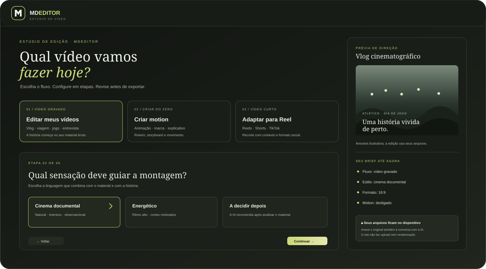

<div align="center">


# MdEditor

### Video direction for any idea — from raw vlog footage to motion created from scratch.

**A portable video editing skill by LucasMsdv**  
Guided brief · specialized workflows · reviewable plan · local interface

[](LICENSE)
[](VERSION)
[](https://agentskills.io/)
[](https://github.com/maisterdev)

[Português](README.md) · [Quick install](#-quick-install) · [Usage guide](COMO-USAR.md)

<br>



</div>

---

## 🎬 What is MdEditor?

MdEditor is a portable AI skill that turns a video request into a clear, specific, reviewable editing workflow. It identifies the type of work, asks only for the decisions that are still needed, organizes available media and references, and prepares a plan an AI agent or editing tool can execute with its actual capabilities.

Use it to **edit raw vlog footage into a cinematic story** or to **create a motion design video from scratch**. Each goal gets its own questions and steps. A vlog does not automatically become an animated screen; a motion piece is not handled as already-recorded footage.

### Workflows

| 🎥 Recorded footage | ✳️ Motion from scratch | 📱 Social recut |
|:--|:--|:--|
| Inspect source footage, find story moments, plan cuts, pacing, color and sound. | Shape the idea, message, script, storyboard, assets and movement before generation. | Adapt existing footage to vertical short-form while preserving context. |
| Motion, titles and effects are off unless requested or approved. | Preview is a direction reference, not the final render. | Captions, reframing and CTA remain configurable choices. |

The local studio shows a conceptual animated preview, step progress and a live brief summary. At the end, review and confirm before exporting. The preview is not a final render or video analysis.

## 🚀 Quick install

Install the `skills` CLI-compatible skill with Node.js:

```bash
npx skills add maisterdev/mdeditor --skill editar
```

Install globally for Codex:

```bash
npx skills add maisterdev/mdeditor --skill editar -g -a codex
```

Install globally for Claude Code:

```bash
npx skills add maisterdev/mdeditor --skill editar -g -a claude-code
```

This project is published at `maisterdev/mdeditor`. Install into other supported agents by adding their CLI agent IDs, for example `-a cursor`.

When the host supports Agent Skills, invoke the installed skill with `/editar`. Automatic discovery and slash commands depend on the AI application. For a chat without skill support, open `SKILL.md`, provide its instructions in the conversation, then ask `/editar` with your brief and media. This does not add slash-command support to a host that lacks it.

## 🧭 How to use it

1. **Choose a workflow** in the studio: edit recordings, create motion, or adapt footage to social media.
2. **Answer the guided steps.** Duration, format, visual direction, pacing, audio and delivery questions adapt to your workflow. Leave unknown details for the AI to recommend after reviewing the source.
3. **Add files and references to the brief.** The site can show local previews, but it does not upload or share those files with your AI.
4. **Review the live summary and preview.** The animation illustrates a direction, not your actual footage or a guaranteed result.
5. **Confirm and export the brief.** Revisit any choice before exporting the prompt/brief.
6. **Attach the original files in the AI conversation/tool** that will edit them. The AI cannot analyze a file that was selected only in the website.
7. **Run `/editar`**, review the proposed plan or first cut, request adjustments, then export using the connected editing tools.

Example — cinematic raw vlog:

```text
/editar
Edit this raw match-day vlog into a natural cinematic story.
Preserve meaningful ambient sound. Do not add motion graphics, animated text or flashy transitions.
Review the attached footage, propose a sequence of moments, and show me the plan before rendering.
```

Example — motion design:

```text
/editar
Create a 20-second motion video about [idea/product].
Use the attached visual references. Propose a scene-by-scene script and storyboard, then confirm before generating.
```

If the agent cannot render video, it should say so and deliver an edit decision list, storyboard, per-shot prompts and instructions for an available editor. MdEditor does not include a video rendering engine or AI generation service.

## 🔎 Compare the workflows

| | Raw vlog | Motion | Reel / Short |
|:--|:--|:--|:--|
| Starts with | Recorded video/audio | Idea, script, assets | Existing source footage |
| First priority | Find the story in the material | Define message and storyboard | Select a clip and preserve context |
| Typical plan | Narrative edit, cuts, finishing | Scene plan, composition, motion | Vertical short version |
| Motion by default? | No | Yes, it's the project | Optional |
| Must attach to AI | Original footage | Available assets/references | Original source |

## 🛡️ Privacy, licenses and project protection

The studio runs locally in your browser. It does not upload media, analyze video, or render exports. Attach the real media to the AI/editor that will work on it.

The app does not upload or process your files. The AI can only analyze video, audio, images and references attached to the conversation or available through a connected tool. See the notes on [license and forks](OPEN-SOURCE.md) and [asset licenses](ASSET-LICENSES.md).

## 📁 Repository contents

```text
SKILL.md                 Portable instructions for the editar skill
agents/openai.yaml       Agent presentation metadata
site/                    Local HTML/CSS/JS studio, no build step
references/              Editing flows, pacing, Galo cinema profile, sources
COMO-USAR.md             Portuguese practical walkthrough
OPEN-SOURCE.md           License scope and forks
ASSET-LICENSES.md        Asset scope and provenance
CONTRIBUTING.md          Contribution guidance
SECURITY.md              Vulnerability reporting guidance
LICENSE                  MIT license
CHANGELOG.md             Release history
```

## 📜 License and credits

The code and materials listed are distributed under the [MIT License](LICENSE). It does not grant rights to third-party trademarks, music, video, images or other assets. Review [ASSET-LICENSES.md](ASSET-LICENSES.md) before reusing assets.

Created by **LucasMsdv**. Instagram and YouTube: LucasMsdv.

### Format and install references

- [Agent Skills format specification](https://agentskills.io/specification)
- [Vercel Skills CLI command reference](https://github.com/vercel-labs/skills/blob/main/docs/commands.md)
