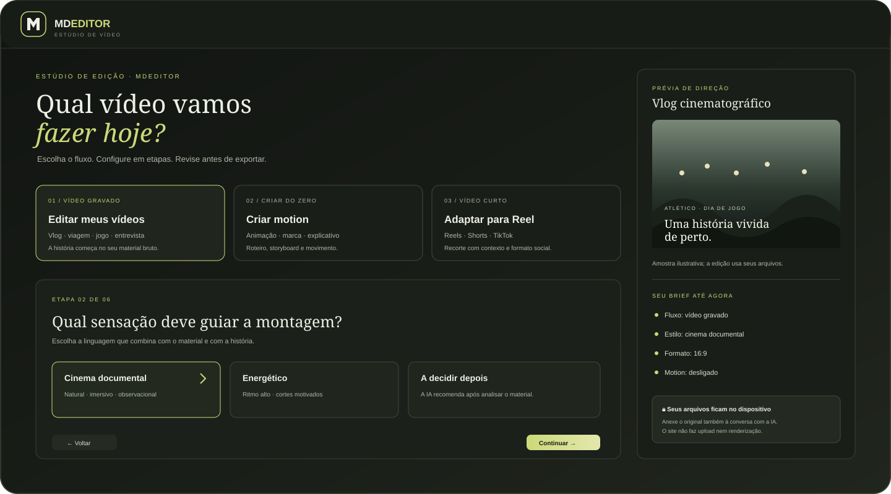

<div align="center">


# MdEditor

### Direção de vídeo para qualquer ideia — do vlog bruto ao motion criado do zero.

**Uma skill universal de edição de vídeo por LucasMsdv**  
Briefing guiado · fluxos especializados · plano revisável · interface local

<br>



[](LICENSE)
[](VERSION)
[](https://agentskills.io/)
[](https://github.com/maisterdev)

**[Começar](#-instalação-rápida) · [Ver a interface](site/index.html) · [Usar passo a passo](COMO-USAR.md) · [English](README.en.md)**

</div>

---

## 🎬 O que é a MdEditor?

MdEditor é uma skill portátil que transforma um pedido de vídeo em um processo de edição compreensível, específico e revisável. Ela identifica o tipo de trabalho, coleta apenas as decisões necessárias, organiza arquivos e referências e entrega um plano que uma IA ou ferramenta de edição pode executar conforme os recursos realmente disponíveis.

Ela serve tanto para **mandar um vídeo bruto e pedir um vlog com narrativa cinematográfica** quanto para **criar um vídeo de motion/animação do zero**. Cada objetivo recebe suas próprias perguntas e etapas. Um vlog não vira uma tela animada automaticamente; uma peça de motion não é tratada como footage já gravado.

> **Em uma frase:** você escolhe o resultado, fornece os arquivos e preferências, revisa o plano e pede `/editar`; a IA executa o que suas ferramentas permitem e informa claramente o que foi feito.

## 🖼️ Veja a experiência

<div align="center">


**Um estúdio local, em etapas, com direção visual e brief acompanhando suas escolhas.**

| 🎥 Editar gravações | ✳️ Criar motion | 📱 Adaptar para redes |
|:--|:--|:--|
| Começa pelos arquivos reais, pelo conteúdo e pelos momentos que contam a história. | Começa pela ideia, mensagem, roteiro, cenas, referências e movimento. | Reaproveita material existente, protegendo a mensagem ao recortar e reenquadrar. |
| **Preview:** clima visual conceitual; a edição final usa seu footage. | **Preview:** referência animada de direção; o resultado depende dos assets e ferramentas disponíveis. | **Preview:** proporção e direção do recorte; a IA precisa receber o vídeo original. |

</div>

O painel do app mostra uma prévia conceitual animada, o progresso das etapas e um resumo do briefing. Ao concluir, você revisa o pedido e confirma antes de exportar. A prévia **não é uma renderização final nem uma análise do vídeo**. O pacote inclui logo vetorial e ícones de fallback; veja [licenças de assets](ASSET-LICENSES.md).

## ✨ O que ela faz

- **Footage bruto / vlog:** inspeciona o material disponível, identifica momentos e timecodes, propõe arco narrativo, cortes, ritmo, cor e som. Motion, textos e efeitos não entram por padrão.
- **Motion e animação do zero:** organiza ideia, roteiro, storyboard, composição, movimento, assets e prompts por cena antes da geração e montagem.
- **Reels, Shorts e TikTok:** cria uma adaptação vertical do material, com duração, gancho, reenquadramento, legendas e CTA configuráveis.
- **Direções distintas:** linguagem cinematográfica, documental, social, editorial ou motion podem ser escolhidas. O formato da rede não define sozinho o estilo.
- **Perfil opcional de vlog esportivo:** inclui uma referência de linguagem cinematográfica para vídeos de dia de jogo, sem impor essa estética a outros projetos.
- **Brief revisável:** decisões, pendências e preferências ficam visíveis antes da execução.
- **Fallback conversacional:** se a interface não abrir, a skill conduz as mesmas etapas diretamente no chat.
- **Transparência de ferramenta:** não afirma que renderizou, analisou ou exportou se o agente não teve acesso ao vídeo ou a um editor capaz de fazê-lo.

## 🚀 Instalação rápida

### Instalar em uma IA compatível com Agent Skills

Com Node.js instalado, execute no terminal:

```bash
npx skills add maisterdev/mdeditor --skill editar
```

Instalação global para o Codex:

```bash
npx skills add maisterdev/mdeditor --skill editar -g -a codex
```

Instalação global para Claude Code:

```bash
npx skills add maisterdev/mdeditor --skill editar -g -a claude-code
```

O endereço deste projeto é `maisterdev/mdeditor`. A CLI `skills` também permite selecionar outros agentes suportados:

```bash
npx skills add maisterdev/mdeditor --skill editar -g -a codex -a claude-code -a cursor
```

Para gerar o texto de instruções e usá-lo em um chat que não instala skills, a CLI também oferece:

```bash
npx skills use maisterdev/mdeditor@editar
```

Ela imprime o prompt da skill para você usar no agente. Nesse caso, anexe também os arquivos de referência do projeto se o chat precisar deles.

> **Sobre “qualquer IA”:** a skill segue o formato aberto Agent Skills, mas a descoberta automática e o atalho `/editar` dependem de cada aplicativo. Em agentes compatíveis, instale-a no agente e invoque `/editar`. Em chats que não carregam skills, abra `SKILL.md` e cole/anexe seu conteúdo como instruções; então envie `/editar` junto com o pedido. Uma instalação não adiciona suporte a slash commands em um aplicativo que não oferece esse recurso.

### Abrir o configurador sem instalar a skill

Baixe ou clone o repositório e abra `site/index.html` em um navegador moderno. O app é estático, sem build e sem dependências. Para a IA trabalhar no vídeo, **anexe o arquivo original na conversa ou na ferramenta de edição conectada**; selecioná-lo no site não o envia.

## 🧭 Como usar — do primeiro clique à edição

### 1. Escolha o fluxo

Abra o configurador e selecione uma das três opções:

- **Editar meus vídeos:** você já gravou e quer uma montagem, por exemplo um vlog de dia de jogo.
- **Criar motion ou animação:** você tem uma ideia ou roteiro e quer produzir cenas/elementos animados.
- **Transformar em Reel:** você tem uma gravação pronta e quer uma versão curta e vertical.

### 2. Responda às etapas do seu projeto

Avance pelas telas, uma decisão por vez. Escolha formato e duração, indique a intenção, o ritmo, a direção visual, o áudio, as legendas e os requisitos de entrega. As perguntas mudam conforme o fluxo. Se ainda não souber algo, use a opção de deixar para a IA recomendar depois de analisar o material.

### 3. Escolha arquivos e referências no configurador

Adicione os nomes/arquivos que quer ter no briefing; o site pode mostrar uma prévia local quando o navegador suporta. **Isso não faz upload e não dá acesso do vídeo à IA.** Anexe as gravações, trilhas, imagens e referências também no chat ou no editor conectado. Nunca presuma que a IA viu um arquivo selecionado apenas no site.

### 4. Confira o resumo e a prévia

Use o resumo lateral para conferir o que já foi escolhido. A animação do preview demonstra a direção visual. Para footage, ela não substitui os seus planos; para motion, não garante que a geração final reproduzirá exatamente a amostra.

### 5. Revise e confirme o brief

Na última etapa, revise as decisões e pendências. Confirme quando estiver satisfeito e exporte o prompt/brief conforme os controles do app. Se mudar de ideia, volte à etapa correspondente.

### 6. Envie o material e chame a skill

Na conversa com a IA compatível, anexe os arquivos originais e o brief exportado, se disponível. Envie, por exemplo:

```text
/editar
Edite este vlog bruto do dia do jogo. Quero uma narrativa cinematográfica e natural.
Preserve o áudio ambiente importante e não use motion, textos animados ou transições chamativas.
Veja os arquivos anexados, proponha a ordem dos momentos e mostre o plano antes de renderizar.
```

Para motion criado do zero, descreva o objetivo e anexe referências:

```text
/editar
Crie um vídeo de motion de 20 segundos para apresentar [ideia/produto].
Use a referência anexada, proponha roteiro e storyboard por cena e confirme o plano antes de gerar.
```

### 7. Revise, peça ajustes e exporte

A IA deve usar os recursos disponíveis, apresentar um primeiro corte ou plano representativo quando possível, revisar imagem/áudio/texto e explicar limitações. Se o agente não conseguir renderizar, peça a EDL/mapa de cortes, storyboard, prompts por plano e passos para levar o plano ao seu editor. A skill não substitui um editor/gerador conectado.

## ⚖️ Comparação dos fluxos

| Aspecto | Footage / vlog | Motion do zero | Reel / Short |
|:--|:--|:--|:--|
| **Ponto de partida** | Vídeos e áudio gravados | Ideia, roteiro e assets | Footage existente |
| **Primeira prioridade** | Entender o material e encontrar a história | Definir mensagem e storyboard | Selecionar trecho e preservar contexto |
| **Saída principal** | Montagem narrativa, cortes e acabamento | Plano por cena, composição e movimento | Versão vertical curta e legível |
| **Motion é padrão?** | Não; só se pedido ou aprovado | Sim, faz parte do projeto | Opcional, conforme direção |
| **Preview do configurador** | Clima conceitual, não seus takes | Exemplo de direção, não render | Moldura/proporção ilustrativa |
| **O que precisa ser anexado à IA** | Gravação original e referências | Assets/referências disponíveis | Fonte original e brief |

## 🛠️ Compatibilidade e requisitos

- **Skill:** formato aberto de pasta com `SKILL.md` e referências locais. Agentes compatíveis podem instalar a pasta; outros podem receber as instruções copiadas.
- **Configurador:** HTML, CSS e JavaScript nativos; navegador moderno; nenhuma instalação de pacote necessária.
- **Edição/render:** depende das ferramentas conectadas ao agente. MdEditor orienta e planeja; não inclui um motor de edição, hospedagem de IA, modelos de vídeo ou serviço de renderização.
- **Acesso aos arquivos:** o vídeo deve ser anexado ao agente/editor que fará a análise. O site não transmite os arquivos.
- **Idioma:** interface e fluxo principal em português do Brasil; adapte idioma e brief ao projeto.

## 📁 Estrutura do repositório

```text
MdEditor/
├── SKILL.md                 # Instruções portáteis da skill editar
├── agents/openai.yaml       # Metadados de apresentação para agentes compatíveis
├── site/                    # Configurador local, sem build ou dependências
├── references/              # Fluxos, ritmo, cinema do Galo e fontes consultadas
├── COMO-USAR.md             # Guia prático em português
├── OPEN-SOURCE.md           # Escopo da licença e uso de forks
├── ASSET-LICENSES.md        # Escopo e origem dos assets
├── CONTRIBUTING.md          # Como propor mudanças
├── SECURITY.md              # Como reportar vulnerabilidades
├── LICENSE                  # Licença MIT do código e conteúdo indicado
└── CHANGELOG.md             # Histórico de versões
```

## 🔒 Privacidade e limites

O configurador roda localmente e não envia arquivos para um servidor. A seleção de arquivo serve apenas para a experiência no navegador. Nenhum vídeo é analisado, enviado ou renderizado pelo site.

O app não faz upload nem processamento dos seus arquivos. A IA só consegue analisar vídeos, áudio, imagens e referências que estejam anexados à conversa ou acessíveis por uma ferramenta conectada. Leia também as notas de [licença e forks](OPEN-SOURCE.md) e [licenças de assets](ASSET-LICENSES.md).

## 🧩 Personalizar e contribuir

Leia [CONTRIBUTING.md](CONTRIBUTING.md), faça fork e abra um pull request com o objetivo e as alterações. Para criar um novo perfil, preserve o princípio central: o estilo acompanha o tipo de material e a intenção; não force linguagem de motion em footage documental.

## 📜 Licença e identidade

O código e os materiais indicados são distribuídos conforme a licença [MIT](LICENSE). A licença não concede direitos sobre marcas, músicas, vídeos, imagens ou outros materiais de terceiros. Consulte [ASSET-LICENSES.md](ASSET-LICENSES.md) antes de reutilizar assets.

## 🔗 Referências do formato e instalação

- [Agent Skills — especificação do formato](https://agentskills.io/specification)
- [Vercel Skills CLI — comandos de instalação e uso](https://github.com/vercel-labs/skills/blob/main/docs/commands.md)

## 👤 Feito por

**LucasMsdv** — criador da MdEditor.  
Instagram e YouTube: **LucasMsdv**.

Se a MdEditor ajudar no seu vídeo, conte como usou e marque o criador. 🎞️
